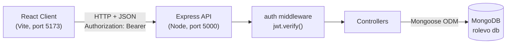

# Rolevo - Smart Job Application Tracker

A modern full-stack **MERN** web application for tracking and organizing job applications, interview timelines, and offers. Each user gets a private, secure account with a dynamic dashboard, visual Kanban workflow, priority dream company bookmarks, and automated follow-up reminders.

Built as an engineering mini-project by **Narasimha**. The codebase is clean, modular, and fully commented for college presentation and viva evaluation.


---

## Contents

- [Features](#features)
- [Tech Stack](#tech-stack)
- [Architecture](#architecture)
- [Project Structure](#project-structure)
- [Database Design](#database-design)
- [API Reference](#api-reference)
- [Getting Started](#getting-started)
- [Demo Account](#demo-account)
- [Environment Variables](#environment-variables)
- [Available Scripts](#available-scripts)
- [How Key Parts Work](#how-key-parts-work)
- [Viva & Technical Questions](#viva--technical-questions)
- [Author](#author)

---

## Features

| Feature | Description |
| --- | --- |
| **Authentication** | Secure registration and login with email + password. Passwords hashed using bcrypt; sessions managed with stateless JSON Web Tokens (JWT). |
| **Data Privacy** | Strict tenant isolation: every database query filters by `req.user.id`, ensuring users only access their own applications. |
| **Full CRUD** | Add, view, edit, and delete job applications with company, role, location, salary/CTC, applied date, interview date, notes, and links. |
| **Status Workflow** | Sequential lifecycle (`Applied` → `Interview` → `Offer` / `Rejected`) with instant dropdown updates. |
| **Audit Timeline** | Every status update logs `{ status, changedAt }` into an embedded history array, visualized as a timeline on the details page. |
| **Follow-up Detection** | Automatically flags applications with an orange **Follow up** badge if still in "Applied" status after 7 days. |
| **Dream Company (⭐)** | Bookmark top-priority or dream companies with a star toggle and filter exclusively for favorites. |
| **Export to CSV** | One-click export of applications into a formatted spreadsheet report (`.csv`) for submission and offline tracking. |
| **List & Board Views** | Switch between a spreadsheet-style data table and a 4-column Kanban board with live search and sorting. |
| **Real-time Analytics** | Live summary cards tracking totals, status counts, and automatic **Response Rate %** calculation via MongoDB aggregation. |

---

## Tech Stack

| Layer | Technology | Purpose |
| --- | --- | --- |
| **Frontend** | React 18, Vite 5 | Reactive component UI and ultra-fast dev server/build |
| **Routing** | React Router 6 | Client-side routing and Protected Route authorization guard |
| **HTTP Client** | Axios | REST API calls with request interceptor automatically attaching JWT |
| **State Management** | React Context API + Hooks | Global authentication state (`AuthContext`) and local component state |
| **Design & UI** | Custom Vanilla CSS (Emerald Theme) | Tailored modern design system without bulky external UI libraries |
| **Backend** | Node.js, Express 4 | RESTful API server, controllers, and custom middleware |
| **Database** | MongoDB, Mongoose 8 | Document database with schema validation and aggregation pipelines |
| **Security & Auth** | jsonwebtoken, bcryptjs | Stateless token authorization and irreversible password hashing |
| **Dev Tooling** | nodemon, dotenv, cors | Auto-restart on edits, environment configuration, and CORS handling |

---

## Architecture



**Request Lifecycle (e.g., Toggling a Dream Star ⭐ or Status):**
1. User clicks the Star icon or changes the status dropdown.
2. Axios dispatches `PATCH /api/applications/:id/star` or `/status` with the JWT in `Authorization: Bearer <token>`.
3. Express passes the request through `cors`, `express.json`, and `auth` middleware (verifies token and extracts `req.user.id`).
4. Controller executes `findOne({ _id: id, user: req.user.id })`, ensuring ownership.
5. Record updates in MongoDB, and the response updates React state and summary cards in real time.

---

## Project Structure

```
rolevo/
├── README.md
├── server/                          # Express + MongoDB API
│   ├── server.js                    # Entry point, middleware, routes
│   ├── seed.js                      # Populates demo account and applications
│   ├── config/
│   │   └── db.js                    # Mongoose MongoDB connection
│   ├── models/
│   │   ├── User.js                  # User schema with hashed passwords
│   │   └── Application.js           # Application schema, statusHistory, isStarred
│   ├── middleware/
│   │   └── auth.js                  # JWT token verification middleware
│   ├── controllers/
│   │   ├── authController.js        # Register and login controllers
│   │   └── applicationController.js # CRUD, star toggle, stats aggregation
│   ├── routes/
│   │   ├── authRoutes.js
│   │   └── applicationRoutes.js
│   ├── .env                         # Server environment variables
│   └── package.json
└── client/                          # React + Vite frontend
    ├── index.html
    ├── vite.config.js
    ├── .env                         # Frontend API endpoint config
    ├── package.json
    └── src/
        ├── main.jsx                 # Mounts root with Router + AuthProvider
        ├── App.jsx                  # Route definitions & ProtectedRoute guards
        ├── api/axios.js             # Axios instance + JWT interceptor
        ├── context/AuthContext.jsx  # Authentication state provider
        ├── utils/helpers.js         # Date formatters & follow-up rules
        ├── components/
        │   ├── Navbar.jsx           # Brand header, user badge, logout
        │   ├── ProtectedRoute.jsx   # Auth guard for private pages
        │   ├── StatsCards.jsx       # Real-time counter metrics & response rate
        │   ├── ListView.jsx         # Table view with star bookmarks
        │   ├── BoardView.jsx        # Kanban board view
        │   ├── StatusBadge.jsx
        │   ├── StatusSelect.jsx
        │   ├── FollowUpLabel.jsx    # Automatic 7-day alert
        │   └── Timeline.jsx         # Status history audit trail
        ├── pages/
        │   ├── Login.jsx            # Sign in with demo auto-fill
        │   ├── Register.jsx         # User registration
        │   ├── Dashboard.jsx        # Main dashboard, search, filter, CSV export
        │   ├── ApplicationForm.jsx  # Add & Edit application form
        │   └── ApplicationDetail.jsx# Detailed view with timeline & star toggle
        └── styles/
            ├── base.css             # Emerald theme variables, buttons, inputs
            ├── layout.css           # Layout grids, topbar, containers
            └── components.css       # Cards, tables, boards, badges, stars
```

---

## Database Design

### `users` Collection

| Field | Type | Rules |
| --- | --- | --- |
| `name` | String | Required |
| `email` | String | Required, unique, lowercase |
| `password` | String | Required, bcrypt hash only (never plain text) |
| `createdAt`, `updatedAt` | Date | Auto timestamps (`timestamps: true`) |

### `applications` Collection

| Field | Type | Rules |
| --- | --- | --- |
| `user` | ObjectId → User | Required, indexed owner |
| `company` | String | Required |
| `role` | String | Required |
| `appliedDate` | Date | Required |
| `status` | String | Enum: `Applied`, `Interview`, `Offer`, `Rejected` (Default: `Applied`) |
| `isStarred` | Boolean | Default: `false` (Dream company bookmark) |
| `jobLink`, `location`, `salaryExpectation`, `notes` | String | Optional |
| `interviewDate` | Date | Optional |
| `statusHistory` | `[{ status, changedAt }]` | Embedded array logging each status transition |
| `createdAt`, `updatedAt` | Date | Auto timestamps |

---

## API Reference

Base URL: `http://localhost:5000/api`

| Method | Endpoint | Auth | Description |
| --- | --- | :---: | --- |
| POST | `/auth/register` | No | Register a new user |
| POST | `/auth/login` | No | Login and receive JWT token |
| GET | `/applications?search=&status=&sort=&starred=` | Yes | List applications with filters |
| GET | `/applications/stats` | Yes | Calculate counts & response rate via aggregation |
| GET | `/applications/:id` | Yes | Get application by ID |
| POST | `/applications` | Yes | Create application |
| PUT | `/applications/:id` | Yes | Update application details |
| PATCH | `/applications/:id/status` | Yes | Update status & record history timeline |
| PATCH | `/applications/:id/star` | Yes | Toggle dream company priority bookmark |
| DELETE | `/applications/:id` | Yes | Delete application |

---

## Getting Started

### Prerequisites
* **Node.js** (v18 or newer)
* **MongoDB** (Local MongoDB Server or MongoDB Atlas)

### Setup & Run

1. **Configure Environment:**
   * Server environment in `server/.env`:
     ```env
     MONGO_URI=mongodb://127.0.0.1:27017/rolevo
     JWT_SECRET=rolevo_jwt_secret_key_2026_narasimha_secure
     PORT=5000
     CLIENT_URL=http://localhost:5173
     ```
   * Client environment in `client/.env`:
     ```env
     VITE_API_URL=http://localhost:5000/api
     ```

2. **Seed Sample Data:**
   ```powershell
   cd server
   npm run seed
   ```

3. **Start Backend Server:**
   ```powershell
   cd server
   npm run dev
   ```

4. **Start Frontend Client (in a second terminal):**
   ```powershell
   cd client
   npm run dev
   ```
   Open **http://localhost:5173** in your browser.

---

## Demo Account

After running `npm run seed`:
* **Email:** `narasimhatanmaikumar@gmail.com`
* **Password:** `rolevo123`

The demo account includes preloaded applications for top companies (Google, Microsoft, Amazon, Zoho, Infosys, Freshworks, TCS, Accenture), interview schedules, dream bookmarks, and automatic follow-up tags.

---

## How Key Parts Work

1. **JWT Authentication Flow:** On login, the server compares the password using `bcrypt.compare()` and signs a JWT containing `{ id: user._id }`. The client stores the token in `localStorage`, and an Axios request interceptor injects `Authorization: Bearer <token>` into every request.
2. **Data Isolation:** `req.user.id` is extracted strictly from the verified JWT. Queries use `{ _id: id, user: req.user.id }`, guaranteeing that users cannot view or mutate another user's records.
3. **Embedded Status History vs Separate Collection:** `statusHistory` is embedded directly into the application document because history is always retrieved together with the application, eliminating expensive joins.
4. **Real-Time Aggregation:** The stats endpoint uses a MongoDB pipeline with `$match` and `$group` to compute status counts and calculate response rate server-side in a single database query.
5. **CSV Export:** The frontend constructs a RFC 4180-compliant CSV string in memory and triggers a clean browser download via a generated data URI blob.

---

## Viva & Technical Questions

**Q1: Why did you choose MongoDB over SQL for Rolevo?**  
*Answer:* Job application tracking involves hierarchical, semi-structured data (like an audit history of status changes). In MongoDB, `statusHistory` is embedded as an array of subdocuments inside the application document. This avoids multi-table joins and allows reading the full application with its complete timeline in a single query.

**Q2: How is security handled for passwords and authentication?**  
*Answer:* Passwords are never stored in plain text. They are hashed using `bcryptjs` with a salt factor of 10 before saving to MongoDB. Authentication uses stateless JSON Web Tokens (JWT) signed with a secret key. Each request verifies the token through an Express middleware, setting `req.user.id` server-side.

**Q3: How is data privacy enforced between different users?**  
*Answer:* The user ID is extracted strictly from the cryptographically verified JWT, never from user-supplied query params or request bodies. Every database query enforces `{ user: req.user.id }`.

---

## Author

**Narasimha**  
*Email:* [narasimhatanmaikumar@gmail.com](mailto:narasimhatanmaikumar@gmail.com)  
*Project:* **Rolevo - Smart Job Application Tracker** (2026)
